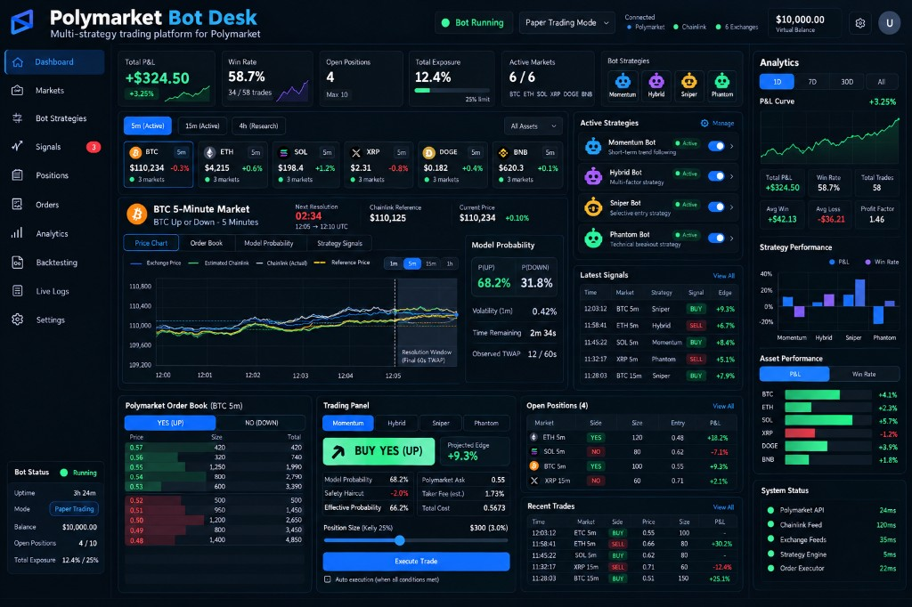
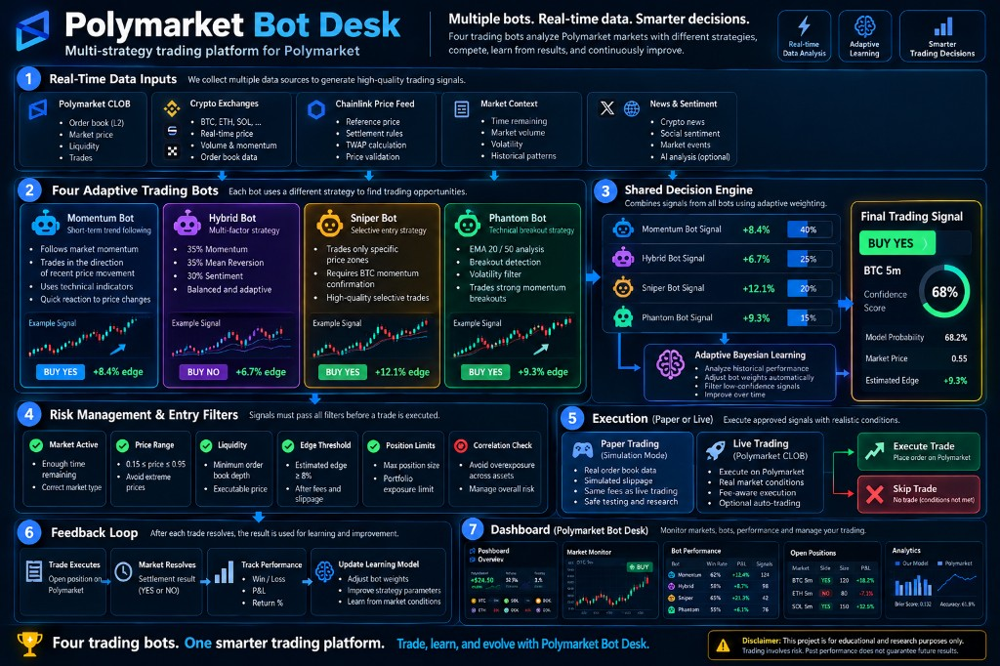

# Polymarket 交易台

[English](./README.md) · **中文**

一套自适应交易机器人系统，在 Polymarket 的 BTC 五分钟涨跌市场上同时运行四种互相竞争的策略。机器人根据已结算交易学习，并按已实现盈亏进化。

> 交易可能亏损。下面的防护只限制已配置的敞口，并避免已知的记账与执行错误；它们不保证盈利，也不能消除市场、流动性、接口、钱包或软件风险。在结果具有统计意义之前，请保持纸面交易模式。

<p align="center">
  
</p>

<p align="center">
  
</p>

## 如何工作

**4 个互相竞争的机器人**在 Polymarket 上每个活跃的 BTC 五分钟市场交易（纸面交易通过 Simmer）：

| 机器人 | 策略 | 说明 |
|-----|----------|-------------|
| `momentum-v1` | 趋势跟踪 | 顺着短期 BTC 价格动量方向交易 |
| `meanrev-v1` | 均值回归 | 用 z-score 与 RSI 对过度延伸的波动反向下注 |
| `sentiment-v1` | 情绪 | 使用社交与新闻情绪信号 |
| `hybrid-v1` | 集成 | 对前三种策略加权组合 |

**自适应学习**：每个机器人按市场状态（价格区间、BTC 动量、一天中的时段）记录胜率。每笔交易结算后，结果回写到贝叶斯学习模型，并调整后续决策。数据越多，机器人越能适应。

**进化**：每两小时，已有至少 20 笔已结算交易的机器人按已实现盈亏排名。经过检验仍亏钱的机器人，会被盈利策略家族的变异后代替换。样本不足的机器人在观察够数之前不受淘汰。

## 架构

```
trading_bot/
  desk.py            # 主循环：发现市场、交易、结算、进化
  learning.py         # 贝叶斯学习引擎（特征提取与胜率跟踪）
  db.py               # SQLite：成交、机器人配置、进化历史、学习数据
  config.py           # 风险限额、API 配置、纸面 / 实盘开关
  setup.py            # 账户设置与连通性验证
  polymarket_client.py # 直连 Polymarket CLOB（实盘交易）
  bots/
    base_bot.py       # 抽象基类，含 make_decision()（策略 + 学习）
    bot_momentum.py   # 动量策略
    bot_mean_rev.py   # 均值回归策略
    bot_sentiment.py  # 情绪策略
    bot_hybrid.py     # 集成策略
  signals/
    price_feed.py     # 通过 Binance WebSocket 获取实时 BTC 价格
    sentiment.py      # 社交情绪打分
    orderflow.py      # Polymarket 订单流信号
  copytrading/
    tracker.py        # 跟踪表现领先的钱包
    copier.py         # 镜像被跟踪钱包的交易
  dashboard/
    server.py         # FastAPI 仪表盘后端
    index.html        # 带市场倒计时的实时网页仪表盘
```

## 安装

### 前提

- Python 3.10+
- 一个 [Simmer](https://simmer.markets) 账户（免费，用于纸面交易）

### 安装依赖

```bash
pip install websocket-client requests fastapi uvicorn
```

### 配置

1. 在 https://simmer.markets 获取 Simmer API 密钥
2. 保存密钥：
```bash
mkdir -p ~/.config/simmer
echo '{"api_key": "your-key-here"}' > ~/.config/simmer/credentials.json
```

3. 运行安装检查：
```bash
python setup.py
```

### 运行

```bash
# 启动交易台（纸面交易）
python desk.py

# 启动仪表盘（另一个终端）
export DESK_DASHBOARD_PASSWORD='use-a-long-unique-password'
python dashboard/server.py
# 打开 http://localhost:8501
```

仪表盘用户名默认为 `admin`，可用 `DESK_DASHBOARD_USER` 覆盖。`ARENA_DASHBOARD_PASSWORD` 与 `ARENA_DASHBOARD_USER` 仍然有效。
不要把凭证和本机路径提交进仓库。launchd 的 plist 文件里的 `/opt/polymarket-bot-desk` 只是部署占位路径，请只在你自己的本地安装中改成正确路径。

## 仪表盘

实时网页仪表盘显示：
- 盈亏统计（今日 / 本周 / 全部）
- 各机器人的表现与胜率
- 活跃 BTC 五分钟市场的倒计时
- 最近成交及其结果
- 进化历史
- 每日收益图

## 纸面交易与实盘

系统默认以 **纸面模式** 启动，使用 Simmer 的 $SIM。要切换到 Polymarket 上的真实 USDC 实盘：

1. 把 Polymarket 钱包私钥保存到 `~/.config/polymarket/credentials.json`
2. 在仪表盘按钮或 `--mode live` 参数中切换
3. 实盘风险限额更严（每笔 $10，相对纸面的 $50）

## 风险限额

| 设置 | 纸面 | 实盘 |
|---------|-------|------|
| 单笔上限 | $50 SIM | $10 USDC |
| 单机器人每日风险上限 | 不设上限 | $50 USDC |
| 全部机器人每日风险上限 | 不设上限 | $100 USDC |

每日风险按保守方式计算：已实现亏损总额，加上未结算仓位的全部成本。新订单会被限制在该机器人与整个交易台的剩余额度之内。盈利不会抵消每日亏损计数。

实盘吃单使用 fill-or-kill，并把价格相对观察到的市场价格的偏离限制在两美分以内；记账使用 CLOB 实际成交的抵押品与份额。实验性做市机器人在异步成交与撤单对账完成之前只做纸面交易。

只有严格的 BTC 五分钟市场可以交易，而且必须处于当前计量窗口内、剩余时间至少 60 秒。缺少时间戳、时长更长或窗口尚未开始的市场会被拒绝。

### 验证

```bash
python -m unittest discover -s tests -v
```

## 联系

**PolyTutor** — Polymarket 机器人、策略自动化与交易基础设施。

- X：[@polytutor](https://x.com/polytutor)
- Telegram：[@polytutor](https://t.me/polytutor)
- WhatsApp：[+1 351 225 2284](https://wa.me/13512252284)
- 微信：


## 许可证

MIT
